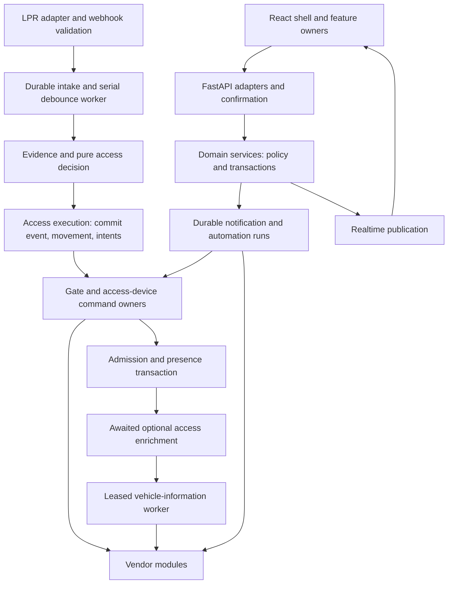
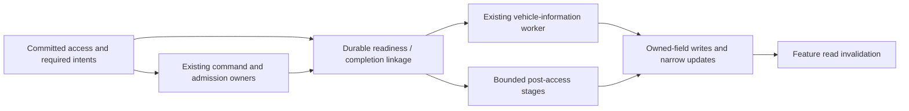

# IACS architecture and maintainability review

Reviewed 7 October 2026. This is an audit and implementation roadmap; it does not implement the proposed refactors.

## 1. Executive assessment

IACS has a credible modular-monolith foundation and unusually strong protection around physical effects and recovery. The recent maintainability work was substantive: access policy and execution have identifiable owners; directory mutations have moved out of routes; directory reads are bounded; workflow dispatch now has checked identities and outcomes; integration composition is inert; and report history queries have been reduced to period data plus predecessors. The MOT addition improved the system further by giving vehicle information its own normalized contract, snapshot store, cache coordination and leased worker.

The main remaining cost is **duplicated knowledge at extension boundaries**, rather than a need to replace the application architecture. A developer adding a workflow action still has to coordinate configuration normalization, execution classification, catalog metadata, handlers and editor behavior. A provider adapter does not yet own all the information needed to identify and freeze its targets. Frontend reads have overlapping shell and feature ownership, with a demonstrated stale-page defect. Optional access work is exception-isolated but still delays the next serial decision. These are worthwhile subsystem changes, not reasons for microservices or a universal framework.

Recommended programme:

1. Repair two demonstrated gaps first: directory/history invalidation and the runtime PDF dependency. These make the baseline more trustworthy.
2. Consolidate the closed set of workflow action definitions and their configuration contracts. This removes the greatest repeated reasoning burden for future feature work.
3. Finish frontend feature ownership and integration editor lifetimes; then give provider configuration and target identity explicit owners.
4. Separate optional access processing from the serial decision path using a bounded, durable handoff, preserving the existing vehicle worker. Remove full-history ranking from that path.
5. Bound background work and shorten report/calendar transaction lifetimes; simplify verified obsolete interfaces along the way.

A complete rewrite is not justified. Bounded replacements of the workflow definition layer and shell data/invalidation layer are justified; retaining parallel old and new engines is not. Effort estimates below are engineering estimates for one developer familiar with the repository, including relevant tests and docs, not delivery commitments. Several stages can proceed independently.

### Reviewed state and evidence

| Item | Reviewed value |
| --- | --- |
| Checkout | `/Users/jas/Documents/Intelligent Access System` |
| Branch | `main` |
| HEAD | `65e1b6d070e6327314ca9bd72c01264496b821fb` — Add vehicle details refresh beside registration |
| Starting worktree | Clean: no staged, unstaged or untracked changes in `git status --short` |
| Source selection | Actual working-tree bytes, including current HEAD; no branch change or older reference substitution |
| Recent work examined | `a5ad27b` maintainability refactor, `1c601c8` standards, `e017bcde3b1901141e1559bdd8cc4d1d4bbc20fb` MOT addition, `65e1b6d` editor refresh, recent navigation change `91e20a1` |
| Instructions | Root `AGENTS.md`; architecture, development, integrations and validation guides; prototype guide for its separate fixture app |
| Operational boundary | Existing installation inspected only for isolation/image metadata. No operational application startup, provider test, hardware command, deployment or production migration |
| Audit edits | This document only; temporary experiments and isolated validation evidence outside the checkout |
| Evidence root | `/private/tmp/iacs-audit-20261007` (`/tmp` resolves to the same temporary area on this host) |

Source references below are repository-relative paths and **line numbers at the reviewed HEAD**. They are stable evidence for this review, not promises that line numbers will survive later refactors. Local temporary evidence is useful for this handoff but is not a permanent CI artifact.

## 2. Scope, inventory and coverage

The tracked inventory contains 708 files: 353 backend, 220 frontend, 73 scripts, 30 prototype, 20 retained images, four guides, two CI workflows and six root files. The architecture scanner examines 215 backend Python modules and 133 frontend TS/TSX inputs (including test setup; 132 excluding it). There are 87 backend Python test files, 37 validation test files, 49 frontend unit-test files, 22 frozen schema-fixture files and 108 locked Python packages. These populations overlap with the total and must not be added together. The full path inventory is retained in `tracked-inventory.json`; history classifications are in `history-a5ad27b.json` and `history-e017bcd.json` under the evidence root.

Inspection combined source/registration searches, bounded source reads, import analysis, commit diffs, tests, a full isolated harness run and targeted inert experiments. Three parallel reviews covered backend domains, frontend ownership, and validation/deployment; their conclusions were reconciled with direct inspection of cross-system paths. This is repository-wide coverage, **not a claim to have manually read every fixture assertion or vendor implementation**. The depth and remaining limits are explicit below.

| Subsystem / responsibility | Key entry points and inspected material | Depth and remaining gaps |
| --- | --- | --- |
| Application lifecycle and composition | `backend/app/main.py`, `composition.py`, `core/task_lifecycle.py`, `db/bootstrap.py`, `db/session.py`, `recovery_hold.py`; startup tests | Startup/recovery branch, ownership stacks, partial-start unwind and shutdown ordering traced. No live start or multi-process load test. |
| API surface, authentication, confirmations | `api/router.py`, `api/dependencies.py`, `api/confirmations.py`, `api/v1/{auth,users,action_confirmations,settings,integrations,access_devices}.py`, `services/{auth,auth_secret_management,action_confirmations,mutation_context}.py` | Route groups inventoried, effect adapters and authority boundaries traced; other adapters sampled with their domain owner. Not a separate penetration test. |
| LPR admission and durable intake | `api/v1/webhooks.py`, `modules/lpr/*`, `services/{lpr_ingest,lpr_webhook_security,lpr_timing,lpr_zone_shadow,access_events}.py`, all `services/access/*` owners | Deep trace of queue, debounce, evidence, decision, commit, hardware and enrichment; retry/restart tests examined. Burst experiment isolates optional delay, not real camera timing. |
| Movement, presence and recovery | `movement_fsm.py`, `movement_ledger.py`, `movement/*`, `movement_reconciliation.py`, `restart_backfill.py`, `resident_recovery*.py`, `expected_presence.py`, `snapshot_recovery.py` | Ownership and recovery paths traced with persistence suites; live phone/camera evidence quality not validated. |
| Device operations | `gate_commands.py`, `gate_controller.py`, `access_devices.py`, `access_device_{commands,configuration,outcomes}.py`, `modules/access_devices/*`, `modules/gate/base.py` | Command journal, frozen targets, failover and provider contract inspected; no mechanical or provider test. |
| Directory, schedules and visitor passes | `schemas/directory.py`, `services/directory/*`, `schedule_{operations,assignments}.py`, `schedules.py`, `visitor_passes.py`; associated routes/models | Mutation/audit transaction ownership, pagination, photo projection, assignment and pass lifecycles examined. External API consumers are not discoverable from this repository alone. |
| Vehicle information | `vehicle_information*.py`, `modules/{dvla,dvsa}/*`, model and migration `20261007_0012`, directory/editor consumers | Deep examination of handoff, leases, provider isolation, snapshots, deadlines and cache semantics. Synthetic scale/Redis/provider fixtures; no credential validation. |
| Workflow definitions and automation execution | `workflows/*`, `automation*.py`, `workflow_dispatch_ports.py`, `workflow_session.py`, API and frontend editors | Catalog → normalization → persistence → frozen plan → preflight → attempted checkpoint → effect → recovery traced. Dynamic config and extension classification are findings. |
| Notifications and actionable outputs | `notification*.py`, `actionable_notifications.py`, `tts_phonetics.py`, `modules/notifications/*`, `modules/announcements/*` | Durable reservation, rendering, recipient/authority checks, transport and uncertain outcomes traced. Provider SDK internals not audited. |
| Integration observations and camera analysis | `home_assistant.py`, `unifi_protect.py`, `integration_effects.py`, vendor clients, `ai/providers.py`, `profile_photos.py`, `snapshots.py`, `vehicle_visual_detections.py` | Interfaces, construction, task/client ownership and representative failure paths inspected. All supported provider families inventoried; not every vendor response shape manually revalidated. |
| Calendar integration | `icloud_calendar.py`, `modules/icloud_calendar/client.py`, integration action, API and editor | Authentication handshake and sync transaction/provider flow traced; no live Apple session or cancellation timing test. |
| Reports, charts, search and investigations | `reports.py`, `report_durations.py`, report template, `leaderboard.py`, `investigations/*`, routes `{reports,search,history,events,telemetry,media}.py` | Query shape and projection reviewed; report runtime smoke, directory/MOT scale evidence; no production EXPLAIN or complete million-row benchmark rerun. |
| Telemetry and realtime | `telemetry.py`, `event_bus.py`, domain events, realtime API, frontend event interpretation | Bounded WebSocket transport contrasted with unbounded listener/persistence tasks; exact-method synthetic fanout probe. Audit writes distinguished from diagnostic tasks. |
| Settings and shared state | `core/config.py`, `services/settings.py`, settings API, integration catalogs, frontend `api/types.ts` and `lib/settings.tsx` | Defaults/secrets/materialization/cache and mutation locking inspected. Provider-specific duplicated configuration knowledge is a finding. |
| Database and schema history | `models/*`, Alembic environment/baseline and revisions; schema, restore, authority and recovery validation suites | Current models/indices and consequential revisions inspected; historical revisions classified and exercised by harness. Not every historical JSON fixture manually read. |
| Frontend shell and data | `app/*`, `api/*`, feature hooks, navigation/routes, request/confirmation/realtime helpers | All route families inventoried; direct request/invalidation trace and targeted reproduction. No live authenticated browser session. |
| Frontend directory/dashboard/reports/history | Views, `views/useHistoryPage.ts`, `features/{directory,dashboard,reports,investigations}/*`, `app/searchPalette.tsx`, `api/search.ts` | Reads, selected-ID hydration, drafts, exports and command lifetimes inspected; report picker and stale history paths checked. |
| Frontend workflow/integration/settings editors | `features/{workflows,integrations,settings,schedules,passes,missedExitRecovery}/*`, settings/user/pass views | Provider branches, defaults/config types, permission and dirty/pending state reviewed. No fresh full viewport screenshot matrix; current unit/fixture evidence only. |
| Shared UI and styling | `ui/*`, `features/integrations/components.tsx`, style entrypoints and feature styles | Layer direction, editor lifecycle and shared controls sampled; no redesign or comprehensive visual/accessibility audit requested or claimed. |
| Tests, checks and benchmarks | `backend/tests/*`, `frontend/src/**/*.test.*`, `frontend/e2e/*`, `scripts/architecture/*`, `scripts/validation/*`, `scripts/benchmarks/*` | Inventory, guards, test selection, type targets and representative behavior tests reviewed; full harness run. Benchmark coverage versus actual runtime artifact gaps distinguished. |
| Build, CI and operation | Dockerfiles, three Compose configurations/override, nginx/Vite, lockfiles, `.github/workflows/*`, operational scripts and `.env.example` | Build-stage/runtime parity, exact locks, bind mounts, ports and isolation reviewed. No dependency upgrades, deployment or production backup rehearsal. |
| Documentation and ancillary material | Root/backend README, four guides, prototype README/AGENTS, tracked artifacts | Source/path/link checks; discrepancies recorded below. Historical screenshots inventoried as retained evidence, not interpreted as current UI. |
| Prototype | `prototypes/premium-dashboard/*` | Separate fixture app, own instructions/build/test surface; no production import found. Its role is not evidence of active production capability. |

### Classification and retirement

Runtime code is `backend/app` and the production `frontend/src` graph. Tests and synthetic schema snapshots have separate roles. Lockfiles are authoritative dependency selections, not hand-maintained implementation. Generated API fixture JSON should be updated through its contract workflow. `artifacts/logs-*` images are retained design evidence. Local `node_modules`, virtual environments, ignored data/logs and installed vendor packages are not first-party runtime source.

Alfred, dedicated WhatsApp/Discord adapters, conversational visitor workflows and AI-authored actions are absent from the active product surface. Historical migrations, frozen upgrade fixtures, audit categories and secret-redaction patterns deliberately retain retired names. Do not remove them. The empty `ai_agent` catalog group at `backend/app/services/workflows/catalog.py:160` is harmless runtime debris, not an active assistant. Camera image analysis, Home Assistant, Apprise and the deliberately unsupported `local` camera-analysis selection remain supported behavior.

### Documentation checked against implementation

The guides correctly describe most new owners, command safety, bounded directory reads and the DVSA worker. Four statements need qualification when implementing this roadmap:

- “Optional enrichment runs separately” means separated source responsibilities, not an independent queue for every stage: `backend/app/services/access_events.py:1478` still awaits it.
- The directory refresh context exists, but the shell does not increment it for several relevant realtime events; a changed seed does not refresh the paged read.
- Reports do use server people search, but `ReportsView` still narrows those results locally and visitor-pass subjects come from a capped list. Runtime PDF capability is not established by a passing development harness.
- `docs/development.md:26` calls the operational Compose override “committed”; `.gitignore:24` ignores it and Git tracks no override. It is local installation configuration. The explicit base-Compose command remains correct.

## 3. Current architecture and execution ownership



The diagram shows responsibility and execution dependencies, not a claim that every branch is taken on every event. Realtime is a notification/read-invalidation channel; database rows, journals and audit establish truth.

| Decision/state | Canonical owner | Transaction/effect boundary |
| --- | --- | --- |
| Accept, suppress or recover an observation | Webhook security; `AccessEventService`; `LprIngestRepository` | Validated intake is durable; suppression and attempts are explainable. Maintenance is a special no-decision boundary. |
| Recognize identity and choose access/direction | `access/evidence.py`, `plate_matching.py`, `decision.py`, movement FSM, schedule evaluation | Exact active indexed candidates precede fuzzy fallback; captured evidence is not continuing authorization. |
| Movement/admission/presence | `AccessExecution`, `movement/admission.py`, `movement/presence.py` and ledger | Commit before hardware; admission requires appropriate evidence; presence follows admission. |
| Hardware target, authority, attempt and uncertainty | `GateCommandCoordinator`, `AccessDeviceService`, command journal/configuration | Frozen target plans; fresh current authority at effect boundary; accepted/unknown are not retry permission. |
| Directory changes and audit | `services/directory/*`; schedule/pass owners | Actor checked in owner, mutation and mandatory audit committed together. |
| Workflow definition vs runtime attempt | Pure definition modules; rule services; separate automation/notification run stores and dispatchers | Captured identities, lease ownership and attempted checkpoints persist before external I/O. Definition data must not supply trusted identity. |
| Vehicle/MOT state | `vehicle_information_contracts.py`, coordination service, snapshot store, worker | Provider I/O outside DB sessions; registration/time guards; notice handoff committed with job result. |
| Configuration | Bootstrap `core/config.py`; product settings service | Flat persisted keys, encrypted secrets, locked/confirmed audited changes; current dispatch configuration rechecked. |
| Frontend server data and drafts | Mixed shell/feature read ownership today; editor hooks own drafts | HTTP cancellation/account lifetimes and selected-ID reads exist; split invalidation is incomplete. |
| Background/client lifetime | Application lifespan and individual start/stop owners | `AsyncExitStack` drains producers before sinks; some unbounded task creation and telemetry shutdown gaps remain. |

### Representative end-to-end paths

**LPR → physical admission.** `/api/v1/webhooks/ubiquiti/lpr` validates source/token/payload; durable intake precedes the in-memory wake/read queue. The worker matches and debounces; evidence loads schedule/identity/movement/camera facts; execution writes the decision, saga and delivery intents and commits. Gate dispatch rechecks current recognition authority and delegates provider I/O. Admission verifies the designated entry evidence before session/presence mutation; eligible garage fanout uses the device owner. Reconciliation resolves pending receipts. Duplicate durable identities and restart/backfill reuse history without replaying hardware. Afterwards the serial worker awaits optional visual/snapshot/presence synchronization/chart publication; that tail is the remaining latency coupling.

**Arrival → MOT.** Live enrichment enqueues `VehicleInformationJob` after access execution. The worker claims at most two jobs from a bounded locked page, has a 120-second lease and a 90-second processing timeout, uses shared cache/coalescing/backoff/throttle, then opens a fresh transaction. It checks lease, deadline and registration, applies allowlisted snapshots, updates linked evidence and reserves MOT/tax notifications with stable IDs and deadline. Restart reclaims expired leases; expired work is terminal; historical replay does not enqueue. The provider isolation is good. The enqueue itself is not atomic with the originating commit.

**Workflow → effect.** Rule API/confirmation → rule owner → normalized JSON → originating transaction reserves occurrence → frozen plan with deterministic operation IDs → dispatcher claim → current rule fingerprint/conditions/authority/preflight → local transactional action or committed attempting checkpoint → handler → domain/provider owner → checkpoint and completion audit. Failure before an attempt differs from unknown result after an attempt. Rechecking authorization at the final command boundary is deliberate and necessary. The weak point is how action-specific semantics are represented and registered, not the existence of those repeated checks.

**Calendar → visitor pass.** Confirmed UI action or registered automation invokes `ICloudCalendarService.sync_all`; saved account/session data feeds a synchronous vendor client via `asyncio.to_thread`. Calendar events map to source-reference-based visitor passes using the pass owner, including durable notification/automation intents. Completion is committed and then published. The current outer transaction spans account reads, provider fetches and pass changes; this differs from the cleaner vehicle-information I/O boundary.

**UI mutation/realtime → directory.** A feature sends a typed confirmed request; the server owner commits and publishes an audit/domain event. Shell interpretation selects data keys and a route token. The shell fetches its compact first page, while the feature's `useDirectoryPage` owns its own filtered/cursor page and selected-ID hydration owns selected records. Several events refresh only shell keys. Since paged state only uses seed items at initialization, the visible page can stay old even after a successful new shell response.

### Shared contracts and their evolution

| Contract | Canonical data owner / consumers | Duplication and migration constraint |
| --- | --- | --- |
| Directory API pages and selected identities | Backend directory schemas/read service; frontend typed directory client, editors, dashboard/search/report selectors | Necessary Python/TS boundary; cursor filter/order identity and selected-ID hydration must survive changes. Old array responses are retired. |
| Vehicle information and history | Pydantic vehicle-information contracts; worker/store, API, editor, visitor pass, notifications, Top Charts | Separate summary/history is valuable. Keep registrations, source/freshness and snapshot cursor identity. Do not revive DVLA-only public APIs or allow clients to author MOT authority fields. |
| Workflow definitions | Pure workflow normalization/catalog plus JSON model fields; rule CRUD, preview, intake, dispatch, frontend defaults/editors | Action `type: str` + `dict[str, Any]` / `Record<string, unknown>` allows drift. Existing execution guards validate identities/state, not full action configuration. Preserve frozen plans/history during stronger validation. |
| Command target/receipt | Device configuration/journal and gate owner; API receipts, dashboard, reconciliation and automation | These are safety contracts, not duplicate UI DTOs to erase. Frozen target fingerprint and delivered/accepted/verified/unknown meanings must remain distinct. |
| Domain/realtime events | Emitting owner; automation/notification durable intake helpers, WebSocket clients and refresh mappings | `dict` payloads and frontend interpretation are partly manual. Start with typed invalidation for affected features, not a universal event-sourcing conversion. |
| Settings | Persisted default/secret catalog, `RuntimeConfig`, settings API, provider code, frontend catalog | Defaults, secrecy, parsing and UI metadata repeat field knowledge. Keep existing persisted/wire keys while extracting provider-owned schemas. |
| Historical state | Migrations, frozen schema fixtures, journal/status contracts, audit redaction | Retired names and old completed payloads remain readable. Unknown unfinished effects must remain held/reconcilable, never normalized into new runnable work. |

## 4. Prioritized findings

Priority here combines future change burden and operational impact. P1 means address early in the programme; P2 means a justified follow-on; P3 is bounded cleanup. Confidence distinguishes direct source/reproduction evidence from projected operational impact. No finding relies on file size alone.

| ID | Finding | Priority / confidence | Indicative effort |
| --- | --- | --- | --- |
| AM-01 | Workflow action semantics have several partial owners | P1 / high | 5–8 days, then 2–4 for notification parity |
| AM-02 | Shell and feature data have overlapping ownership and incomplete invalidation | P1 / high, reproduced | 1–2 days repair; 4–7 days coherent ownership migration |
| AM-03 | Provider abstraction stops before configuration and target identity | P2 / high | 4–7 days |
| AM-04 | Integration panels do not own coherent form/request lifetimes | P2 / high | 3–5 days |
| AM-05 | Optional work still occupies serial access processing; handoff has a commit gap | P1 / high | 5–8 days including recovery proof |
| AM-06 | Top Charts repeats full-history work on arrivals and loads unnecessary media | P2 / high structural; latency unmeasured | 3–6 days, plus projection if justified |
| AM-07 | Background listener/telemetry tasks have no admission bound | P2 / high structural and synthetic | 3–5 days |
| AM-08 | Report/calendar transactions outlive database work | P2 / high structural; contention unmeasured | 2–4 days per owner |
| AM-09 | Final runtime image lacks an active PDF dependency | P1 / high, reproduced | 0.5–1.5 days |
| AM-10 | Type coverage and retained performance evidence require manual coordination | P2 / high | 1–3 days |
| AM-11 | Obsolete decision fields and event bridges obscure authority | P3 / high | 1–2 days |
| AM-12 | Presence/forecast reads retain unrelated blobs and population-sized collections | P2 / high structural | 2–4 days |
| AM-13 | Directory mutation duplicates vehicle-information invalidation knowledge | P3 / high | 0.5–1 day |

### AM-01 — Give action configuration and execution semantics one definition owner

**Evidence.** `backend/app/services/workflows/catalog.py:175` defines public actions; `backend/app/services/workflows/automation_definition.py:215–250` accepts actions and normalizes configuration using prefixes and a separate integration map at line 45. `backend/app/services/automation_actions.py:105` maps handlers; `backend/app/services/automation_policy.py:9` classifies hardware; `backend/app/services/automation_execution.py:31` classifies actions allowed after uncertainty; `backend/app/services/automations.py:647` separately names transactional notification toggles. `backend/app/services/automation_webhooks.py:248` classifies actions for webhook hardening. Frontend `frontend/src/api/workflows.ts:24–45` uses string action types and `Record<string, unknown>`; `frontend/src/features/workflows/automationModel.tsx:36` supplies defaults; `frontend/src/features/workflows/AutomationEditor.tsx:91–195` interprets types/configuration.

`backend/app/services/workflows/execution_contracts.py:90–99` correctly checks persisted identity and that config is an object, but does not validate action-specific fields. `normalize_actions` silently drops unsupported entries, while `normalize_action_config` can discard unrecognized fields. A new action can therefore be registered correctly yet lose configuration, receive the wrong transactional treatment, or need an editor cast/default fix elsewhere.

**Existing protection.** `backend/tests/test_workflow_execution_contracts.py:92` checks handler/catalog coverage. `backend/tests/test_automations.py:808` checks hardware registration and `:816` checks the integration definition map. These are real protections; this is not a claim that registrations are unchecked. They do not establish complete config round-trips, transaction classification, uncertainty policy and frontend editor parity.

**Root cause and consequence.** The extraction separated execution code from the facade, but a feature's semantic definition remains distributed. `AutomationService` legitimately coordinates leases, transactions and final authorization; it should not need a new string branch to recognize every new transactional action. Notifications have distinct delivery semantics and useful planner/recipient/authority owners; their channel normalization/rendering/dispatch is another closed contract to strengthen, not a reason to merge both run stores.

**Recommendation.** Replace the definition layer with a small, statically assembled set of typed built-in definitions. Each defines its config schema, defaults, labels, transaction/effect class, maintenance handling and behavior after uncertainty. Derive catalogs and validation from those definitions; use checked exhaustive handler bindings at composition. Generate or mechanically check the TypeScript discriminated union and default fixtures; keep handwritten feature controls. This is a closed application contract, not runtime plugin discovery or a form-generation platform.

**Migration/alternatives.** Initially preserve existing type strings and valid JSON shapes. Distinguish validation of new writes from safe reading of historical completed runs. Do not re-plan or re-authorize an attempted run from edited definitions. Reject invalid edits explicitly; hold unknown unfinished plans for review. Add a format version only when the wire meaning actually changes, with explicit migration fixtures. A smaller alternative is to add exhaustive classification/config tests around today's lists; useful immediately, but it leaves the knowledge duplication. A whole workflow-engine replacement would risk mature recovery behavior without solving more of the demonstrated problem.

**Benefit, risk, verification.** Highest expected reduction in feature coordination; medium migration risk because persisted plans and effect classifications matter. Prerequisites are a catalog/round-trip inventory and characterization of all existing variants. Verify every registered action has one schema, handler, mode and editor; reject missing bindings; test malformed/stored configs, transaction-local audit, final authorization and attempted/unknown recovery. Exercise E2 should add no action-specific branch to the dispatcher, store or facade.

### AM-02 — Complete the move from shell collections to feature-owned reads

**Evidence.** `frontend/src/app/useShellRefresh.ts:43` fetches the first directory pages. `frontend/src/features/directory/reads.ts:17` initializes state from seeds; its read effect at `:30–42` responds to query/cursor/refresh token, not changed seed data. `frontend/src/app/realtimeRefresh.ts:19–25` selects person/group/vehicle shell keys without refreshing the corresponding directory routes; `:33` maps vehicle-information updates to the same vehicle impact. `useShellRefresh.ts:62` increments the route token only when requested. `routes.tsx:69–70` passes both shell seeds and token into Vehicles.

The same split affects Events: `realtimeRefresh.ts:7–9` requests the shell `events` key but omits the `events` route. `routes.tsx:76` passes tokens and target identity, but no shell event collection, to `EventsView`, whose history request is owned at `frontend/src/views/EventsView.tsx:77–90`. Refreshing `/events?limit=40` does not refresh the history page.

**Reproduction.** A temporary Vitest fixture composed the actual shell/directory hooks with mocked HTTP: one person, two initial people GETs, then a person audit event produced a third shell GET containing the updated name while the feature page retained the old name. It passed as a characterization of the defect. Log: `frontend-invalidation-reproduction.log`. No live API or browser session was used.

**Root cause.** The shell partially migrated from authoritative collections to seed data without migrating invalidation ownership. This causes unnecessary first-page work and stale pages, not merely extra props. Selected-ID hydration is a separate necessary read and must remain; counting it as duplicate list work would be wrong.

**Recommendation.** Immediately correct affected route invalidations and add composed tests. Then make directory/history pages own their query results, errors, pagination and invalidation. The shell should own account, layout/navigation and truly shared operational status. Compose typed resource invalidators from features; an event can invalidate a resource without the shell fetching an unused copy. Keep the existing coordinator's coalescing and request/account lifetime protection. Dashboard can continue its feature-scoped compact reads and explicit identity hydration.

**Alternatives/migration.** Making seeds synchronize pages would need special handling for non-first pages and active searches, and preserves dual ownership; do not use it as the target design. A broad state-management library migration is unnecessary. Move one resource family at a time, with one active list owner per route; remove its shell setter/requirement/seed props in that same stage. No database or public API migration.

**Benefit/risk/verification.** High change-burden and responsiveness benefit; medium frontend regression risk. Preserve dirty drafts, selected records beyond page one, cancellation, stale/error distinctions and account change behavior. Verify initial/navigation/mutation/realtime request counts separately: one owner request per displayed page, plus justified selected-ID reads; a coalesced burst refreshes the active query and metadata once; Events shows new-activity behavior; out-of-order responses cannot overwrite a mutation. E5 should not edit shell data state or a central list of feature event policies.

### AM-03 — Extend provider ownership through validation and frozen identity

**Evidence.** `backend/app/modules/access_devices/base.py:151` is a useful typed I/O port, but `binding_is_commandable` at `:52–72` explicitly accepts HA URL/token and ESPHome devices. `registry.py:12` stores instances and `:26` repeats the provider key list. `backend/app/services/access_device_configuration.py:228–248` treats every non-HA provider as ESPHome when forming physical identity; `:250–280` does the same for configuration fingerprints. `backend/app/services/settings.py:633–669` names provider fields to lock affected targets, and `:689–709` separately determines admission validation. `RuntimeConfig` and its construction repeat provider settings, while frontend catalogs/panels carry another representation.

**Problem.** A new adapter satisfying `AccessDeviceProvider` is not enough. Missing a shared identity/fingerprint branch could misidentify duplicate physical targets or fail to bind confirmation to the configuration actually used. Those are necessary safety decisions but provider-specific facts have the wrong owner. Current HA/ESPHome behavior is not shown incorrect.

The frontend repeats the closed provider set too: `frontend/src/views/AccessDevicesSettingsView.tsx:191–211` saves bindings by looping over HA/ESPHome, `:59–71,106` branches discovery, and `frontend/src/features/settings/accessDeviceModel.ts:41–50` plus `AccessDeviceEditor.tsx:37–40,96–97,119` encode provider labels/config/rendering/types. A newly configured adapter can therefore be missed by Save Device unless those consumers change as well.

**Recommendation.** Add a pure binding-policy contract per supported provider: validate/configured predicate, physical identity, relevant configuration fingerprint inputs and affected setting keys. Inject the static policy map into configuration/settings composition; keep commandability, target-plan ownership, locking order and final authority in the domain service. Build provider keys from the actual closed registry. Organize typed provider setting groups so default/secrecy/validation/materialization metadata has one declaration while preserving persisted flat keys.

**Alternative.** Retain switches and add third-provider exhaustive tests: cheap but perpetuates the feature's edit burden. Replacing the device subsystem is unwarranted; its journal/command contract is a strength. No plugin loading or general DI container is needed.

**Benefit/migration.** E1 becomes adapter + pure provider policy + settings/editor + composition + contract tests, without changing command or authorization semantics. Medium risk: fingerprints and pending receipts are durable contracts. Preserve byte-equivalent existing identity/fingerprint outputs initially; if they change, finish/reconcile pending work or explicitly version target snapshots. Never silently reinterpret pending targets. Estimated 4–7 days including parity and simultaneous-configuration-change tests. Acceptance: injected fake third provider passes discovery/commandability/frozen target/configuration locking tests without HA/ESPHome branches in shared owners.

### AM-04 — Provider panels need form and request ownership, not just JSX extraction

**Evidence.** `frontend/src/features/integrations/IntegrationModal.tsx:63–83` retains provider booleans/state, `:101–157` request effects and `:158–319` testing/save operations. Its dirty/busy guard at `:67–69` sees parent form/saving state, while `frontend/src/features/integrations/providers/ApprisePanel.tsx:19–21`, `frontend/src/features/integrations/providers/ESPHomePanel.tsx:37–51` and `frontend/src/features/integrations/providers/ICloudCalendarPanel.tsx:21–32` own local drafts and operations. Parent Done/close at `:328,451–452` cannot see those states. An inert test with real modal/panel components, mocked HTTP and a reject-discard confirmation stub showed an unsaved Apprise URL closing without confirmation (`frontend-provider-lifetime-reproduction.log`).

**Consequence.** Adding provider fields or operations can require modifying both a nominal provider panel and the shared modal, with different rules for cancellation, saving, pending dismissal and draft preservation. The extraction made rendering easier to read but did not establish a complete provider editor owner.

**Recommendation.** Make each managed provider editor own its typed draft, baseline, validation, reads, tests and save lifecycle. The integration modal chooses one editor and provides common chrome/close/confirmation behavior through a small explicit editor-state contract. Keep the useful generic field editor for simple providers: DVSA was added without an `IntegrationModal` edit. Existing UI lifecycle helpers remain shared and independent of features. Provider-specific operation buttons should participate in the same busy/dismiss contract, even when they do not save the whole form.

**Migration/alternatives.** Move one existing provider at a time, removing the corresponding state/effects/branches from the modal in the same change. No server contract migration required. Extracting more presentational components alone will not fix this; a generic settings-form framework would add unnecessary complexity. Benefit is localized provider work and predictable drafts; 3–5 days, medium UI risk. Verify provider switch/unmount, stale responses, secret masking, confirmed tests, saving, Escape/backdrop dismissal, dirty draft retention and failed operations. E1 should add one editor registration without adding provider-specific modal state.

### AM-05 — Separate optional access completion from decision throughput

**Evidence.** `AccessEventService` constructs an unbounded queue at `backend/app/services/access_events.py:129`; `_process_queue` at `:441` owns serial processing. `_finalize_window` executes access and then awaits `AccessEnrichment.run` at `:1478`. In `backend/app/services/access/enrichment.py:73–141`, visual enrichment, snapshots, visitor enrichment, zone shadow, HA presence synchronization, realtime and overtake evaluation are awaited serially. `independently` at `:48` catches exceptions but awaits the operation; it is not concurrency or queue isolation.

Vehicle provider I/O is already separate: `backend/app/services/vehicle_information_jobs.py:76–119` claims bounded leased work and calls providers outside a DB session. Preserve that. However, `enqueue_arrival` at `:36–50` opens and commits another transaction after the access commit. A crash between those commits can leave an otherwise successful arrival without its optional job. Duplicate access execution returns before enrichment (`backend/app/services/access_events.py:1473–1477`), so retry is not a reliable repair for this handoff.

**Measured mechanism.** An inert probe executed the current `AccessEnrichment.run` body with fake collaborators and a 50 ms snapshot delay. Across three repetitions, 20 equivalent event outputs completed in median 1,031.80 ms, with the last next-core boundary at 979.65 ms; zero-delay total was 0.78 ms. Two events took 104.18 ms versus 0.07 ms. This demonstrates propagation of an optional wait, not real provider latency or production throughput. Source/method/results are retained as `enrichment_latency_probe.*`.

**Recommendation.** Define the end of serial processing as committed access execution/admission and durable required handoffs. Reserve vehicle enrichment through an in-session method; wake only after commit. Reservation must not make work runnable too early: the worker reads `VisitorPass.arrival_event_id` (`backend/app/services/vehicle_information_jobs.py:145`), which admission links later. Release readiness after the appropriate durable execution/admission phase, and make late admission linkage/completion idempotent so provider results cannot miss their intended visitor. Introduce a narrowly scoped durable post-access completion record only for remaining work that must survive a crash. This extra mechanism is justified by the demonstrated serial wait and handoff gap, and should reuse the existing lease/deadline approach rather than add Redis/Celery or a universal job engine. Stages that are explicitly expendable diagnostics can instead be bounded/coalesced with visible drop counts.

Also bound the existing intake's in-memory admission, using its durable pending-row reader (`backend/app/services/lpr_ingest.py:72–91`) as the backlog authority and a bounded ID/read buffer or wake signal. An overflow must not discard acknowledged durable reads or block webhook intake behind optional work. There is a prerequisite: intake persists normalized input at `backend/app/services/access_events.py:225–227`, then samples gate observation at `:241` and carries that in the queued read before processing records it (`:398–434`). Persist this observation/readiness with its original timestamps before replacing queued reads with IDs; rehydration must not silently resample a later gate state and change direction. Preserve duplicate identities, debounce order and maintenance terminal states; do not invent fresh recognition authority when refilling the buffer. Bound active debounce state and accumulated reads as well as queued objects, with an explicit overload outcome. Drop redundant wakeups, never durable observations. This reuses existing durable intake rather than introducing another broker.

Keep identity/schedule/movement decisions, command journal transitions and per-device ordering in their current owners. Do not parallelize complete LPR decisions to conceal slow optional work. Presence state remains in its admission transaction; HA synchronization reads the latest committed desired state, so a delayed entry sync cannot overwrite a later departure. A snapshot job must retain event/camera provenance and a freshness deadline; a later current-camera image must not masquerade as evidence of an old arrival. Overtake ordering needs its own ordered projection or an agreed coalescing policy.

**Migration/risk/verification.** 5–8 days, medium-high risk, additive job/checkpoint schema if durable optional stages are retained. Store immutable event IDs and stage status, not detached ORM objects; guard late writes, duplicate claims, registration changes and current desired state. Do not backfill historical events into live work. Stop old executors before deploying changed job contracts; expired/attempted state survives rollback and recovery hold. Verify crash before/after commit, duplicate wake/lease, cancellation, provider outage, stale snapshot deadline and burst queue age; identical access decisions/command IDs and required notices must precede optional completion. E2 and the next enrichment should add a post-access participant without extending serial finalization.

### AM-06 — Remove full-history ranking and photo materialization from the access tail

**Evidence.** Each granted known entry calls `LeaderboardService.evaluate_known_overtake` from `backend/app/services/access/enrichment.py:136–141`. `backend/app/services/leaderboard.py:104–144` aggregates all granted-entry history by `(registration_number, vehicle_id, person_id)`; `LIMIT` is applied after aggregation. The known-leader query selects whole Vehicle/Person ORM rows before serializing photo URLs. `_unknown_leaders` at `:171–194` ranks all eligible snapshot history before limiting chart output. The directory's indexed selected-plate latest-row strategy is not used there.

**Consequence/root cause.** Presentation/ranking is coupled to every access completion, and bounded output is mistaken for bounded work. Query work grows with retained history; full model loading also materializes unnecessary photo blobs. This is a demonstrated query-shape problem, not a measured production latency claim.

**Recommendation.** First project only chart fields and use bounded latest-snapshot lookup for the returned registrations; benchmark equivalent ranks/ties/photos. Move overtake work out of the serial tail under AM-05. If exact per-event overtake alerts are required at scale, maintain a small idempotent count/latest projection with the existing composite grouping key from committed eligible events, with an ordered update and rebuild/checksum path. Do not cache authorization. If only current rankings matter, a coalesced read after a burst is simpler; alert timing is a product decision to settle before choosing that alternative.

**Cost/risk/verification.** Projection-only/query repairs: 3–6 days including evidence; persistent counters are additional schema/rebuild work and medium risk. Preserve current eligibility (known `vehicle_id`, GRANTED, ENTRY), which is not the same as verified admission, as well as the composite grouping key. Count semantics for corrections, deleted/reassigned vehicles, timestamp ties and historical repair must be specified. A rebuild never sends notifications. Compare small and million-event fixtures, EXPLAIN scanned/returned rows, query count, peak allocation and equal ranks/alert identities. Add `raiseload`/column-selection assertions so photo removal is real. A bounded subsystem replacement of chart reads/projection is reasonable; replacing reports/directory reads is not.

### AM-07 — Bound asynchronous work and give diagnostics a shutdown owner

**Evidence.** `backend/app/services/event_bus.py:331–355` creates one task for every matching listener for every event; `_listener_tasks` tracks cleanup, not capacity. WebSocket queues at `:159` are bounded to 250 and slow clients disconnect, which is good, but does not bound listener tasks. `backend/app/services/telemetry.py:671–681` creates one task per persistence operation; `enqueue_trace` at `:512` adds persistence and publication tasks, spans add more. `backend/app/main.py:92–164` drains named services but does not register `telemetry.flush` before engine disposal. UniFi's tracked task creation at `backend/app/services/unifi_protect.py:449` is another capacity point; its semaphore bounds active probes, not necessarily waiting task allocation.

**Measurement.** Using exact extracted `_dispatch` and `_schedule` methods with blocked fake consumers, 20 inputs retained 60 listener tasks and 20 telemetry tasks (~192 KB peak Python allocation); 2,000 retained 6,000 and 2,000 tasks (~20.64 MB). All callbacks drained and counts matched. This is an artificial worst-case consumer pause, on host Python 3.9.6; it is evidence of the mechanism, not production memory prediction. See `task_fanout_probe.py` and `task-fanout-results.json`.

**Recommendation.** Remove no-op subscriptions (AM-11), filter subscription event types, and use bounded owner work for actual listeners. Coalesce durable-run wakeups and latest-state cache refreshes; never silently drop mandatory workflow/audit work. Use a bounded diagnostic batch writer with explicit sampling/drop counters for expendable telemetry, and drain/cancel it while the DB remains available. Durable audit stays in domain transactions. Track queue age, capacity and dropped/coalesced counts rather than relying on task-set length alone.

**Alternative/risk.** A semaphore around each coroutine still permits unbounded waiting tasks, so does not solve admission. An external task broker is unnecessary. 3–5 days, medium risk if ordering or audit/diagnostic distinctions blur. Verify slow subscriber isolation, cancellation, partial startup/shutdown, bounded task/allocation growth and durable audit equivalence. Do not remove the already-useful WebSocket/Redis bounds.

### AM-08 — End read transactions before independent slow I/O

**Evidence.** `backend/app/services/reports.py:78–138` builds a report snapshot using a session, renders PDF at `:101`, and commits the export/audit only at `:138`. `render_person_movement_report_pdf` at `:693–714` launches a browser per export. The session's read transaction therefore spans rendering; no application export concurrency limit is visible. `backend/app/services/icloud_calendar.py:264–294` similarly wraps `_sync_all_in_session`; account reads at `:313` and per-account `asyncio.to_thread(fetch_events)` at `:327` share a transaction that later updates passes. Vendor calls are off the event loop, but database connection lifetime is still extended. Cancellation of a `to_thread` await is not cancellation of its synchronous SDK call.

**Recommendation.** Reports: build an immutable bounded snapshot, end its read transaction, render under an explicit small capacity limit, then atomically persist export metadata/audit after rechecking the actor and expected inputs. Clean up orphan temporary files on cancellation/failure. Keep report output proportional to selected data; define supported export size or stream/chunk output if actual workloads require it. Calendar: snapshot account identity/configuration, fetch without DB ownership, then revalidate the account and apply its normalized events in a short owner transaction with source-reference idempotency and serialized account sync. Explicitly own outstanding SDK work and its timeout/cleanup.

**Alternatives/tradeoffs.** A larger DB pool conceals connection occupancy and more Chromium processes consume more memory. A separate report/calendar service is unnecessary. Per-account calendar transactions change partial-success granularity and need documented behavior; retain whole-sync atomicity only if it is a real requirement, in which case collect all normalized input before the final transaction. Preserve transactional pass intents and mandatory audits.

**Benefit/risk/verification.** 2–4 days per owner, medium risk, normally no data migration; a durable export state is optional only if requested recovery semantics justify it. Measure DB connection hold time, peak renderer count/RSS and cancellation cleanup under 1/5/concurrent exports and delayed fake accounts. Verify equal report snapshot/duration output and calendar pass identities, account revocation during fetch, cancellation and failed audit commits. Pool starvation is plausible, not measured here.

### AM-09 — Test the final runtime image's PDF capability

**Evidence/reproduction.** `backend/Dockerfile:42–52` installs Chromium and OS dependencies only in `development`; `:61` derives `runtime` from `base`. Active `backend/app/services/reports.py:693–694` launches Chromium. A disposable network-none container using `iacs-backend:production-20261007-mot-e017bcd` failed launch because the Chromium executable did not exist. The image's report source, Python manifest and lock hashes matched the checkout; the Dockerfile and those paths have no diff between the MOT commit and HEAD. This corroborates the current source defect without claiming a newly reconstructed image build. Log: `runtime-pdf-smoke.log`.

**Root cause.** Final artifact capability is not exercised. Report unit tests mock rendering (`backend/tests/test_reports.py:723–734`); an image build and the tooling harness do not prove native runtime prerequisites.

**Remedy/verification.** Put the required browser/system dependencies in runtime ancestry or a shared PDF-runtime stage, retaining development-only tools separately. In CI render the actual report template to a nonempty `%PDF` as the runtime user, with network disabled, synthetic data and temporary output. Measure image size/build time. 0.5–1.5 days, low business/data risk; no migration, rollback is image-only. Replacing the renderer is a larger alternative requiring fidelity proof and is unnecessary for this defect. Playwright is an active production dependency, not YAGNI.

### AM-10 — Make type coverage and performance evidence follow the owner

**Evidence.** `scripts/validation/validate.py:30–80` and `:83–118` separately enumerate checked-body and stricter modules; `backend/pyproject.toml:55–59` uses skipped imports, so importing a new owner does not guarantee checking its body. The MOT commit correctly updated both lists; a future extraction can forget one. The target named `typed-contracts` adds `--disallow-untyped-defs`; it is not unrestricted whole-app mypy strictness and still permits explicit dynamic values.

The suite inventory in `scripts/validation/recovery_checks.py:90–101` already fails on unclassified validation suites: preserve this. The dependency scanner catches static cycles, vendor/service back-imports, specific route writes and known side-effect owners, not all dynamic imports, aliases or ORM mutations.

Evidence retention also has a concrete gap: `scripts/validation/test_directory_operations.py:83` prints `DIRECTORY_TARGET_SCALE_EVIDENCE`, but the passing `pytest -q` run captures it; the retained suite log/JUnit do not contain those metrics. Assertions passed, but the guide's promised retained measurement is missing. The MOT suite's JSON artifacts are a working pattern. The plate test asserts the generic index plan without retaining the actual plan text.

**Recommendation.** Derive checked-body targets from a single strict/owner group definition, prefer package targets for cohesive new owners, and guard coverage of protected packages. Do not weaken lint/type flags or enlarge architecture exceptions. Write benchmark JSON/plans into retained test artifact paths, separately from assertions. Add final-runtime PDF and composed frontend invalidation checks at the appropriate existing boundaries.

**Benefit/risk/verification.** 1–3 days, low runtime risk. No data migration. Negative tests should prove that an unclassified owner/suite or missing runtime dependency fails; a new module in an already-covered package should need no second filename list. Preserve harness/source-selection tests and full isolated recovery checks. Avoid a second competing validation framework or time-based unit assertions.

### AM-11 — Remove misleading obsolete authority and no-op bridges

**Evidence.** `access/decision.py:14,40` exposes `AccessPlan.gate_command_required` based on captured CLOSED state. The runtime reads only `plan.allowed/direction/decision`; `backend/app/services/access/execution.py:164–167` deliberately determines whether to reach the command owner regardless of that old captured state. `backend/tests/test_access_architecture.py:52` still asserts the unused plan field. The persisted movement/command/payload fields with the same name **are used** and must not be removed wholesale.

`backend/app/services/automations.py:952–978` subscribes to realtime but returns for every origin supported by `automation_triggers_for_origin` (`backend/app/services/workflows/automation_definition.py:554`); other events map to no trigger. `backend/app/services/notifications.py:862–878` has a live `notification.trigger` wakeup, followed by an unreachable visitor fallback because every supported visitor event is already returned above. The pure mapping helpers are used by durable intake (`access/delivery.py`, `visitor_passes.py`) and must remain.

**Recommendation.** Remove the unused pure-plan field and its now-unnecessary gate-state/suppression inputs if caller tracing confirms no separate use; keep authoritative execution/journal fields. Remove the no-op automation subscription and dead notification fallback, retaining explicit durable wakeup and pure event-to-intent mapping. Delete the empty retired catalog group. Replace internal `getattr` compatibility around guaranteed protocols only after updating fixtures to the real port. These changes clarify authority and remove recurring work without architectural machinery.

**Cost/risk/verification.** 1–2 days; low-to-medium risk because similarly named persisted fields are legitimate. No persisted-data migration should be required. Search public schemas, journals, tests and registrations; preserve captured-gate-state direction evidence and current command authorization; test exactly one durable occurrence per origin and no realtime-created duplicate. An alternative is deprecation comments, but there is no demonstrated public consumer of the pure internal plan field requiring a compatibility period.

### AM-12 — Extend compact read discipline to presence and forecasting

**Evidence.** `backend/app/api/v1/events.py:378–396` reads every Presence row and full related Person entities to return ID, name, state and timestamp. `backend/app/services/expected_presence.py:57–80` reads all active Person rows and twelve weeks of full AccessEvent entities plus vehicle/owner/assignment people; `:81–85` builds a second historical list. `HistoricalPresenceEvent` at `:26–31` needs only identity/name/time/direction. Photo data and event raw payloads are unrelated input. The time window is bounded; rows and bytes within it are not. This is distinct from the already-fixed directory reads and does not mean full MOT history is embedded in events.

**Recommendation.** Project the predictor's actual input columns and batch attribution. Preserve recorded person identity before the current single-active-assignee fallback (`:281–300,402–419`). Give presence consumers bounded filtered/ID reads or the exact aggregate they need; inspect dashboard/report demands before changing the API. Do not make clients concatenate all pages. A separate forecast read model is premature until the projected query has been measured.

**Benefit/risk/verification.** 2–4 days; low risk for projection, medium for attribution/API migration. No schema change required for projection; public presence response migration must update consumers together and check external use. Compare equal output at 20/2,000 people and low/high event density, enlarge irrelevant photos/raw JSON independently, and retain row counts, query plans, payload and allocation. Reject lazy-load fallback with tests. Runtime latency and DB memory impact remain unmeasured. Caching predictions would introduce freshness choices and is not a substitute for removing unnecessary materialization.

### AM-13 — Keep provider-information reset with its write owner

**Evidence.** `backend/app/services/directory/vehicles.py:121–133` deletes `VehicleInformationSnapshot` and clears eleven MOT/tax/information fields when the plate changes. `backend/app/services/vehicle_information_store.py:29–78` owns the snapshot and summary writes. A new derived fact requires updating both the feature store and an unrelated directory field-reset list. Existing stale-registration tests cover today's fields, not automatically tomorrow's additions.

**Recommendation.** Add a narrow in-session invalidation/replacement operation to the information store and invoke it from directory's registration mutation. Directory continues owning the user edit, actor, assignments, audit and commit; the information owner knows its own aggregate. Keep explicit feature-owned fields, not reflective “clear every nullable column” logic.

**Benefit/risk/verification.** 0.5–1 day; low risk, no schema migration. E4's next provider fact no longer changes a directory reset list. Test a populated aggregate crossing a plate change, late provider completion, new-plate cache data and preservation of user-edited make/model. Moving the entire vehicle mutation into the information service would invert ownership and is not recommended.

## 5. Feature-change exercises

These are analytical changes, not proposed product commitments or implemented features. Each separates necessary cross-layer work from accidental coordination. New files named here are proposals, not claims that they already exist. Public API evolution and external consumers need deliberate migration even when internal clients can change together.

### E1 — Add a third managed cover provider

**Example and current extension.** Add a supported REST cover controller with discovery and credentials. Implement `AccessDeviceProvider` (`backend/app/modules/access_devices/base.py:151`) with explicit definitely-not-sent, rejected, accepted and unknown behavior. Existing Home Assistant/ESPHome adapters demonstrate the port; keep the device/gate command owners.

| Current edit / new file | Why required | Necessary or accidental |
| --- | --- | --- |
| New `backend/app/modules/access_devices/rest_cover.py` and provider tests | Vendor protocol, observation timestamps, timeout/cleanup and command certainty | Necessary boundary |
| `modules/access_devices/registry.py` instances and key list | Make provider discoverable | One composition registration necessary; parallel key list accidental |
| `modules/access_devices/base.py:binding_is_commandable` | Recognize provider configuration | Accidental provider knowledge in shared base |
| `services/access_device_configuration.py:binding_identity`, `target_snapshot`, `provider_order` | Freeze physical endpoint/configuration and ordering | Domain policy necessary; provider-specific endpoint branches accidental |
| `services/settings.py:DEFAULT_DYNAMIC_SETTINGS`, `SECRET_KEYS`, `RuntimeConfig`, loader, target-setting lock sets | Persist/encrypt settings and block configuration races | Storage/security necessary; repeated provider field declarations/sets accidental |
| Settings/integration API and typed frontend API, integration catalog | Configuration/discovery surface | Necessary adapters; prefer existing generic setting route where sufficient |
| New provider editor under `features/integrations/providers`, plus current `IntegrationModal` branches for custom workflows | Managed device discovery/draft/requests | Provider editor necessary; parent state/pending branches accidental |
| `views/AccessDevicesSettingsView.tsx` discovery and two-provider binding-save loop; `features/settings/accessDeviceModel.ts`, `AccessDeviceEditor.tsx` provider config/types | Bind a configured physical device | Necessary presentation; duplicated closed provider lists/config switches are accidental |
| Device configuration/target-plan/journal/provider/lifecycle tests; docs and type coverage | Safe extension and setup | Necessary; manual double type list is avoidable |

**Easy omissions/checks.** Registering the adapter alone leaves `binding_is_commandable` false; the non-HA fingerprint path assumes ESPHome. A missed affected-settings mapping can change pending target configuration without the intended owner check. The hardcoded frontend save loop can omit the new binding despite a working configuration screen. Existing tests protect two providers, not all imaginable adapter metadata. Add shared conformance fixtures with an injected third provider and no production registration.

**Smallest useful improvement and proposed path.** AM-03 makes provider policy own its config/identity facts; AM-04 makes the managed editor own its lifetime. Add adapter, typed binding policy/settings group, editor and tests, then one backend binding and one frontend component registration. Existing command journal, admission, automation dispatcher and shell collections do not change. No new table is inherently required: existing binding/config records can represent this provider. If target fingerprint representation changes, pending receipts require explicit version/transition handling. The accepted/uncertain safety contract remains non-negotiable.

### E2 — Add an automation action to refresh a known vehicle's information

**Example.** `vehicle_information.refresh` takes a concrete vehicle ID and reserves bounded optional work through the vehicle-information owner. It must not directly call DVSA from the dispatcher, accept webhook payloads as authorization, or use a captured old registration as current identity. Product authorization for this new action is a design decision; the exercise exposes the mechanical extension burden.

**Current edits.** Add action metadata to `workflows/catalog.py`; add its allowed/config shape in `automation_definition.normalize_actions/normalize_action_config`; add a handler to `AutomationActionExecutor.handlers`; define intake resolution in `automation_intake.reserve_occurrence` if a durable target must be captured. Add an in-session, idempotent explicit-job reservation to the information owner (arrival-only event IDs are not an appropriate invented origin for a manual automation action). Decide local-transaction versus external-attempt treatment in `automations.prepare_action_dispatch`, continuation-after-uncertainty in `automation_execution`, maintenance/hardening policy, and current vehicle/action authority. Add frontend `api/workflows.ts` type, `automationModel.tsx` defaults and `AutomationEditor.tsx` controls. Tests include `test_workflow_execution_contracts.py`, `test_automations.py`, `scripts/validation/test_automation_dispatch.py`, `test_automation_recovery.py`, vehicle job persistence and frontend workflow editor/list tests. Any new job-origin contract needs an additive migration with old arrival jobs still interpretable.

**Repeated facts.** The action type/config fields, whether it mutates locally or starts an external attempt, whether maintenance pauses it and whether it can follow an uncertain prior action all appear outside the handler. Existing parity tests catch a missing handler/catalog entry, but not all these semantic omissions. A developer could add the handler and observe a successful test while normalization silently removes `vehicle_id`, or the runner records an external attempt around what should have been an atomic local reservation.

**Proposed path.** Add `workflows/definitions/vehicle_information.py` containing one typed definition and `workflows/actions/vehicle_information.py` containing its domain adapter; bind the handler in the static checked action map. The definition supplies catalog/default/config/mode metadata. A typed frontend editor consumes its checked/generated config union. The job store still owns leases and provider limits. The facade, dispatcher and run store do not learn the action's string. Preserve plan order, explicit current authority and idempotent operation ID. Tests cover reservation and action completion in one transaction, rollback, duplicate claim, vehicle deletion/plate change and deadline. This is two legitimate layers, not a lowest-file-count contest.

### E3 — Add a calendar exception to existing access schedules

**Example.** Extend the existing schedule representation with a dated exception while preserving vehicle → unambiguous owner → default precedence. This is a useful positive control: the present structure already supports localized policy change.

**Current/proposed owners.** `services/schedules.py:evaluate_vehicle_schedule` (`:76–122`), `evaluate_person_schedule` (`:125–153`), `_evaluate_schedule` and `normalize_time_blocks` own evaluation/normalization. `schedule_operations.py` owns mutations/audit; `schedule_assignments.py` owns assignments and locking. Extend their definition/schema and, only if representation requires it, model/migration. `api/v1/schedules.py`, frontend schedule contract/client and `features/schedules` editor/presentation adapt the new representation. Add fixtures in `test_schedule_evidence.py`, `test_schedule_operations.py`, isolated schedule/recognition authority tests and frontend schedule tests.

Access evidence and `backend/app/services/access/authorization.py:258–276` both call the same evaluator; command/device schedule checks must continue doing so. They should not each implement exception logic. No provider, notification transport, Top Charts or shell data setter needs to learn what an exception means. New files can be limited to a migration and focused test fixture; a new service is not justified solely by this change.

**Likely omissions/checks.** Timezone/DST boundaries, exception precedence, legacy JSON defaults and a schedule edit after enqueue but before effect. Existing final authority tests protect the second checkpoint but need a new exception case. A stored display snapshot does not authorize dispatch. If normalizer semantics change for saved schedules, migrate/validate records explicitly; keep historical explanation readable.

**Small improvement.** Strengthen the schedule definition's typed shape/round-trip tests if adding the new representation reveals ambiguity; do not move a working pure policy merely to match a folder plan. Success is that the feature changes its owner, schema/editor and behavioral tests, while access and hardware call sites remain untouched. Repeated calls at intake and dispatch are necessary freshness checks, not duplicated business logic.

### E4 — Add a last-recorded-mileage summary from vehicle information

**Example.** Expose a compact provider-derived mileage value with unit, source and observation date. It must remain unknown when absent, not fabricated zero, and must not affect access eligibility.

**Current extension path.** Extend `vehicle_information_contracts.py` normalization/resolve models, `vehicle_information_store.py:apply_information/information_summary`, and if summary storage is needed `models/core.py:Vehicle` plus a migration. Extend `schemas/directory.py:VehicleResponse`, `directory/representation.py:serialize_vehicle`, `frontend/src/api/vehicleInformation.ts` and the directory compliance presentation. Use provider/cache/persistence/MOT-summary fixtures and `VehicleEditor`/history tests. A detail-only value could instead be derived from the existing saved snapshot without new summary columns; do not add storage before settling the read use case.

Necessary edits span persistence, API, frontend and tests. Accidental coordination is `backend/app/services/directory/vehicles.py:127–128`, where a future author must independently add the new provider field to the registration-reset list. Date/source/freshness interpretation must not be copied into report/chart templates. Current tests protect existing stale writes but cannot infer that a newly added field also needs clearing.

**Proposed path.** AM-13 makes the information store own apply/reset as one aggregate. Add the fact there and expose it through the chosen contracts/consumer; directory's stable `invalidate_information_in_session` call does not change. Additive nullable fields preserve existing rows and old snapshots. Late lookup results retain registration/time guards; user-edited descriptive fields remain protected. New files: a migration if required and focused fixtures; no generic repository or provider registry is necessary. Acceptance: the exercise changes no access executor, hardware service, visitor mutation field list or directory reset implementation.

### E5 — Show existing MOT freshness alongside dashboard activity

**Current extension.** `api/vehicleInformation.ts` already describes the summary; `api/types.ts:Vehicle` carries it. `features/dashboard/useDashboardDirectory.ts` resolves visible registrations/identities; `frontend/src/features/dashboard/model.ts:188–229` maps activity and `frontend/src/views/DashboardView.tsx:308–345` renders the current event rows. `OperationalWidgets.tsx` supplies related status/snapshot components if needed. Add component/model tests and scoped styles. No provider call, data migration or new backend policy is necessary.

**Accidental dependency.** Freshness currently depends on central `realtimeRefresh.ts` mapping `vehicle_information.updated` to vehicle shell keys, `navigation.tsx` selecting vehicles, `useShellRefresh` fetching first-page seeds, App setters/route props and downstream seed-triggered identity reads. A plate outside the first page is refreshed indirectly through seed changes. Removing an apparently unused seed can break the new badge. A separate new screen legitimately needs a URL/role/lazy-route registration; it should not require shell data setters, clear-state code, error labels and feature event branches.

**Proposed path.** Dashboard owns its compact inputs and identity hydration plus a small `features/dashboard/invalidation.ts` predicate. Shell composition transports events and coalesced invalidation; it knows no MOT fields. Reuse canonical source/freshness semantics, not a frontend provider-precedence implementation. A narrow summary rendering helper is justified if reused by both dashboard and directory; otherwise keep it local. Existing screen needs no new route file; a new screen adds its feature view and ordinary route/navigation composition only.

**Verification.** A vehicle outside the first page receives an information update → one needed identity refresh → dashboard badge changes. Separately, the same invalidation on the directory route preserves an open dirty editor. Test bursts, logout/account change, stale responses, provider-unavailable retained summary and no accidental provider request. Existing helper mapping tests alone did not catch AM-02; test event through visible result and request count. This is the principal acceptance exercise for AM-02.

### Corroborating history: what the MOT addition actually required

`e017bcde3b1901141e1559bdd8cc4d1d4bbc20fb` changed 64 files: 44 runtime/contracts, 13 tests/fixtures, four guides, two validation selection files and one migration. Those categories describe roles, not defects. Supporting refactoring is mixed into the runtime category and should not be inferred from file count.

| Work in the commit | Assessment |
| --- | --- |
| DVSA OAuth/HTTP adapter, normalized records and provider outcomes | Necessary new integration boundary and domain contract. Credentials/raw payloads stay out of public state. |
| Summary provenance, separate snapshots, leased jobs and additive migration | Necessary to support saved history and reliable bounded background work; not gratuitous abstraction. Downgrade refuses populated durable work. |
| Shared lookup/cache/throttle/backoff and old DVLA call migration | Valuable supporting refactor. Access no longer waits for DVLA/DVSA provider calls, Top Charts uses cache-only information, setup/manual flows share coordination. |
| Directory summary/representation, API lookup/refresh/history, editor history/refresh, admin role plumbing | Necessary data and presentation layers. Source-specific frontend DVLA representation was retired rather than retained as a second API. |
| Access execution/hardware/payload and visitor enrichment edits | Mostly adapting consumers/removing old DVLA timing/representation, not a new reason for hardware to know MOT policy. No evidence MOT decides admission. Still reveals the broad post-access boundary and provider-reset leakage (AM-05/13). |
| Notifications/Top Charts edits | Consumers intentionally adopt the shared information contract. Unknown-notice enrichment still has its own three-second budget in the serial notification dispatcher; exception isolation there is not queue isolation. Measure that lane before adding more optional lookups. |
| Frontend integration fields/coercion and central realtime mapping | Small generic provider addition worked without changing the modal. Repeated settings metadata and shell invalidation are avoidable future coordination (AM-02/03), with the stale invalidation reproduced. |
| Tests, docs, harness/type registrations | Required verification and safety explanation. The two manually synchronized type lists are avoidable (AM-10); test coverage itself is not overhead to remove. |

`a5ad27b` changed 221 files and removed the previously tolerated cycle chains through provider/business imports. It introduced inert composition/ports, directory service/read owners, workflow action/rule/intake owners, report duration/query improvements and dashboard/report feature hooks. Formatting, tests and type work contribute substantially to its size. Current static cycle detection is zero; it would be incorrect to repeat the old cycle finding. The residual issues are partial contract/data/lifetime extractions, not proof that the refactor accomplished nothing. The integration modal's earlier panel extraction was not introduced by that commit. `65e1b6d`'s registration-side details refresh stayed mostly in the vehicle editor/hook/tests and is an example of a cohesive follow-up.

## 6. Target architecture

Retain a single deployable backend and React frontend. The target is fewer places that know a feature's semantics, with explicit transactions and lifetimes. Existing narrow protocols are justified by testing and external-effect isolation even when only one implementation exists.

The following is a proposed layout for affected owners only, not a request to move every file:

```text
backend/app/services/
  workflows/
    definitions/          # pure typed configs + metadata for built-in actions
    actions/              # typed adapters to domain owners
    execution_contracts.py
    catalog.py            # projection of definitions, not a second definition
  automation_*            # keep durable runner/intake/store responsibilities
  notification_*          # retain separate delivery/recipient/authority semantics
  access/
    evidence.py           # identity, schedule, direction evidence
    decision.py           # actual pure decision; no discarded command predicate
    execution.py           # durable decision and required reservations
    post_processing.py    # optional stage policy, readiness and owned fields
  vehicle_information_*   # existing provider coordination/store/leased worker
  integration_configuration/
    home_assistant.py     # pure provider settings/binding identity facts
    esphome.py
  access_device_configuration.py  # targets, locks, frozen plans, not vendor branching

frontend/src/
  app/                    # auth, navigation, common chrome, event transport/composition
  features/directory/     # page queries, selected identities, invalidation, editors
  features/dashboard/     # compact inputs, visible-identity hydration, invalidation
  features/workflows/     # typed definitions/controls, draft and request lifetimes
  features/integrations/
    IntegrationDialogFrame.tsx
    SettingsIntegrationEditor.tsx  # simple scalar field-based providers
    providers/            # each managed provider owns complete editor lifetime
  ui/                     # independent lifecycle/accessibility primitives
```

A concrete action contract could be as small as the following conceptual interface. Use existing Pydantic/dataclass/typing tools; the exact generic syntax is an implementation choice:

```python
@dataclass(frozen=True)
class ActionDefinition:
    type: str
    config_model: type[BaseModel]
    execution_kind: Literal["transactional", "external"]
    effect_class: Literal["hardware", "configuration", "provider_job"]
    maintenance_behavior: Literal["pause", "allow"]
    may_follow_uncertain_action: bool
    editor_key: str
    # label/default/catalog data; no service or provider construction

# Static composition binds every supported type to a typed domain adapter.
# Transactional adapter: uses caller's session, never commits or sends externally.
# External adapter: runs only after the durable attempted checkpoint.
# Hardware adapters still invoke the existing final authorization/command owners.
```

There is no need for dynamically registered plugins. The useful invariant is that every supported type has exactly one definition and one compatible handler; metadata, schema and execution mode cannot disagree. Configuration validation must happen on write and on loading executable persisted state. The runner should handle execution modes and checkpoints, not action-specific strings. Preserve separate representations where they mean different things: definition, frozen target, attempt and receipt are different contracts.

For provider target configuration, a narrow pure interface is sufficient:

```python
class BindingPolicy(Protocol):
    def validate(self, binding, provider_settings) -> None: ...
    def physical_identity(self, binding, provider_settings) -> tuple[str, ...]: ...
    def fingerprint_inputs(self, binding, provider_settings) -> object: ...
    def is_configured(self, binding, provider_settings) -> bool: ...
    @property
    def affected_setting_keys(self) -> frozenset[str]: ...
```

Use concrete typed binding/settings arguments in implementation. The configuration service owns hashing/frozen target construction and lock policy. Provider policy supplies only its own facts; vendor I/O remains in `modules`. This avoids both business back-imports and a global configuration object that each new integration must edit repeatedly.

For optional access work, use an explicit bounded contract: event ID, fixed stage, schema version only if needed, not-before/readiness, absolute deadline, lease token and terminal outcome. Core execution reserves intent; a durable readiness transition or completion-link protocol prevents racing visitor admission. The worker reloads current records and writes only stage-owned fields. A notification or HA effect must retain its own certainty/current-state semantics. Do not use a generic arbitrary Python callable payload, assume every stage is retryable, or enqueue historical repairs into the live worker.



For frontend invalidation, keep composition small: feature predicates classify relevant events into typed resource invalidations; the existing/coherent coalescer delivers at most an active read plus one trailing refresh. Each feature retains its query key, abort controller, account generation and dirty draft separation. Do not introduce a second authority cache in App. A route component and navigation/role registration remain legitimate central composition edits.

### Incremental change versus bounded replacement

| Boundary | Incremental option | Bounded replacement | Recommendation |
| --- | --- | --- | --- |
| Workflow definitions | Add missing config/mode parity tests to existing maps | Replace normalization/catalog/classification with closed typed definitions; keep stores/runner | Replacement of definition layer is worth 5–8 days; staged action-family migration is acceptable only with one active definition per type and a removal endpoint. |
| Shell data | Add missing route tokens and remove a few unused reads | Move resource ownership/invalidation to feature boundaries, retaining shell transport/coalescing | Immediate fix followed by resource-by-resource replacement; no state-library rewrite. |
| Integration dialog | Extract more presentational JSX | Replace parent-owned provider state with complete managed editors plus generic scalar editor | Complete editor ownership is the meaningful boundary; each provider can migrate independently and delete its old parent code. |
| Optional access tail | Move only expendable diagnostics into bounded best-effort work | Replace inline optional tail with explicit durable completion stages where promised | Durable replacement justified for required eventual work; preserve existing vehicle queue and command owners. Decide loss semantics per stage. |
| Top Charts | Project columns and bound latest-snapshot reads | Rebuildable exact count/latest projection | Do query work first; projection only with explicit overtake semantics and retained benchmark evidence. |
| Entire backend/DB/frontend state | Package/focus a few owners | Whole-system rewrite, microservices or general frameworks | Not justified. These would expand migration and operational burden and re-prove mature safety behavior. |

## 7. Simplification and YAGNI decisions

Reachability was checked through imports, registrations, routes, background subscribers, tests and script/configuration entry points. The absence of a static call was not treated as sufficient evidence for deletion.

| Candidate | Reachability and current value | Decision / safe action |
| --- | --- | --- |
| Pure plan's discarded command field | Produced and tested, but authoritative runtime recomputes elsewhere | Remove internal field/unused inputs under AM-11; retain persisted saga/receipt semantics. |
| Automation realtime bridge and notification visitor fallback | Registered, but every supported origin returns before its mapping; durable intake uses the mapping directly | Remove bridge/fallback, keep mapper and notification wake. Add negative duplicate-intake tests. |
| `AccessExecutionResult` fields `window`, `gate_command_required`, `gate_open_skipped`, `gate_outcome` | Constructed with no identified runtime reads; similarly named durable fields are active | Narrow result DTO after whole-repository/test tracing; do not delete durable receipt fields. Low-priority follow-up to AM-11. |
| External-admission private method | `backend/app/services/access_events.py:805` invokes `AccessExecution._persist_external_gate_open_admission` | Make the supported operation an explicit interface or place it with the admission owner. Do not add a second implementation just to avoid a private call. |
| Unused shell reads | Settings home requests groups/schedules/vehicles (`navigation.tsx:30`) but route passes only navigation/user (`routes.tsx:123–124`); Events ignores shell event list | Remove in AM-02 along with obsolete seeds/invalidation requirements. Dashboard's actual data stays. |
| OAuth login placeholder | OpenAI/Gemini catalog sets `oauth`; modal button only reports that OAuth is inactive (`frontend/src/features/integrations/IntegrationModal.tsx:369–376`) | Remove flags/button/import together. No implemented OAuth capability or historical-data contract to preserve. |
| Artificial provider progress delays | Reachable UI code stages 180/260 ms waits (`IntegrationModal.tsx:175,187,228`; integrations `frontend/src/features/integrations/components.tsx:68–70`) | Remove while moving editor lifetimes; real pending requests provide progress. No claimed backend throughput gain. |
| Report subject search duplication | `ReportsView.tsx:62` fetches first 500 passes, then filters locally; `:76–81` narrows server people results using a smaller field set | Use existing bounded visitor-pass `q` search (`backend/app/api/v1/visitor_passes.py:156–169`) and detail hydration; add cursor continuation only if browsing requires it. Stop hiding valid server people matches. Test a subject beyond 500 and a server-only searchable field. Do not fetch all pages. |
| `_commit_if_supported`, protocol `getattr` wrappers | `backend/app/api/v1/integrations.py:76`, `backend/app/ai/providers.py:231`; concrete sessions/providers have known methods, tests may use partial fakes | Simplify only after fixtures inject proper ports. No need for a framework; keep uncertainty handling at genuine external boundaries. |
| `IACS_SEED_DEMO_DATA` | Parsed in `backend/app/core/config.py:44`, only logs “ignored” in `backend/app/db/bootstrap.py:31` | Candidate to retire with deployment docs after checking external configuration users; do not implement seed behavior to justify keeping it. |
| Calendar SDK fallback shapes | Vendor adapter has alternate API paths; locked library is one version but old serialized sessions/data exist | Verify against locked library and fixtures before simplifying. No unsupported-version compatibility promise should be invented. Not proven unused in this audit. |
| Legacy cover request aliases | `resolve_legacy_cover_key` consumed by public command and confirmation endpoints | Public consumer usage unknown; do not remove solely on absence of frontend callers. If retired, change both routes, docs, confirmation binding and migration notice together. |
| `Vehicle.person_id` alongside assignments | Deliberately derived only for exactly one assigned person (`backend/app/services/directory/assignments.py:65–89`); authority uses unambiguous attribution | Retain; not a redundant column to delete without domain/data migration. |
| Camera provider interfaces / local unsupported provider | Active camera analysis contract and explicit no-external-analysis selection | Retain; one implementation or deliberate unsupported mode can be useful isolation. |
| Python Playwright / pgvector image | Active report renderer; supported historical migration chain includes vector use before retirement | Retain/fix runtime packaging. Removing Alfred does not make these safe to delete today. |
| Historical retired names / snapshots / redaction | Upgrade fixtures, migration checksums, durable audit interpretation | Retain. Current retirement tests ensure active routes/settings/catalogs remain retired. |
| Prototype / screenshots | Separate fixture/design evidence, no production import | Retain or archive under an explicit evidence policy if size becomes costly; not production complexity. |
| `scripts/backend-pytest`, `scripts/load-test.mjs` | Operational entry points; load test defaults to live container names and publishes Redis events | Do not run for this audit. Clarify ownership/use or retire only after external script use is established; a disconnected static call graph is insufficient. |
| V2 privacy CI workflow | Manually dispatched processor of external candidate bundles | External process, not current app functionality; confirm process retirement before removal. |

The dependency inventory did not establish an unused runtime package worth a speculative deletion. Prefer direct removal of proven obsolete application paths to broad dependency churn. Current locks and relevant security fixes should remain intact.

## 8. Performance assessment

### Measurements made during this audit

| Workload / method | Result | What it establishes / limits |
| --- | --- | --- |
| Directory/MOT summaries, 20 synthetic vehicles plus fixture, 25 stored tests per snapshot added; isolated PostgreSQL suite | 21 returned rows, 4 queries before/after; payload 12,105 bytes before/after; peak Python 472,508 → 472,165 bytes | Equivalent output and no history-materialization growth for this summary path. Tiny allocation difference is noise. |
| Same at 2,000 synthetic vehicles plus fixture | 50 returned rows, 4 queries before/after; payload 28,879 bytes before/after; peak Python 687,891 → 688,101 bytes | Target-scale summary/history separation works. Query-plan JSON retained; not end-to-end production latency or DB memory. |
| Exact access enrichment method, 2 and 20 fake events, 0/50 ms snapshot delay, three repeats | 2-event total median 0.07/104.18 ms; 20-event total 0.78/1,031.80 ms; 20-event last core marker 0.74/979.65 ms | Awaited optional delay propagates into the next serial boundary; unchanged output sequence. No DB/provider imports and no proposed replacement timing. |
| Exact event-bus/telemetry methods, 3 blocked listeners + 1 blocked diagnostic persistence/input | 20 inputs: 80 retained tasks, ~0.193 MB peak; 2,000: 8,000 tasks, ~20.637 MB | No admission bound under blocked consumers; all tasks subsequently drained. Artificial host Python probe, not production RSS. |
| Real shell/directory hooks, mocked API, one person | 2 initial people reads; update causes third shell read while feature data remains stale | Current request duplication and correctness defect. Actual App initially gates route mount, so reads can be serial; no user-latency claim. |
| Real integration modal + Apprise panel, mocked API and discard reject | Done closes unsaved child draft, no discard prompt | Complete-editor-lifetime defect; not a throughput benchmark. |
| Runtime image, network-none Chromium launch | Fails: executable absent; relevant image source/dependency hashes match checkout | Current runtime packaging gap. No live application or reconstructed new build. |
| Locked frontend suite/build in harness | 49 files / 284 tests; unit run ~58.31 s; Vite build phase ~1.25 s; main JS 294.96 kB / gzip 91.56 kB | Development feedback/bundle baseline on constrained synthetic tooling. Lazy routes already split features. No browser interaction performance profile. |
| Full isolated harness with exact-lock offline reuse | 141 checks, ~510.83 s (~8m31s) on this run | Cost of complete safe validation. Includes isolated database setup/restore; do not remove safety checks solely to reduce elapsed time. |

Environment: host Darwin 27.0.0 arm64; bundled host Python 3.12.14 for harness; Linux 7.0.14 OrbStack aarch64/glibc2.41 test containers, Python 3.12.14, uv 0.12.13, npm 10.9.8, Docker 29.4.0. Harness containers use 1 CPU/1,536 MB limits and exact-lock reused dependencies. The source-extracted method probes used host Python 3.9.6 because they import no application code and execute only compatible method bodies; they do not substitute for Python 3.12 application tests. Host contention and artificial delays limit timing interpretation.

### Demonstrated scaling concerns versus profiling still required

| Path | Evidence class | Next measurement / decision |
| --- | --- | --- |
| Serial optional finalization | Measured dependency propagation; actual latency distribution unknown | Arrivals in bursts, oldest durable ingest age, stage p50/p95/p99, hardware deadline denials; test isolated injected delays and bounded overload. |
| Top Charts/overtake | Full-history aggregation/window query and blob projection visible in SQL construction | 20/2,000 vehicles; 10k/1m events; actual/generic plans, scanned rows and returned rows, exact tie/rank equality, allocation/payload. Decide alert ordering before caching/projecting. |
| Presence forecast | Population/time-window materialization and unrelated ORM blobs visible in code | Same count/time output with large photos/raw JSON; increasing events/day within 12 weeks; profile grouping memory and query plans. |
| Notification/automation dispatch | Each background dispatcher executes runs/actions serially; optional unknown-notice lookup has a three-second bound; action timeout 120 s | Queue age/expiry, 1/10/100 queued runs under slow fake provider; distinguish required order within one run from independence between runs. Do not parallelize effects without per-target/current-authority proof. |
| PDF export and calendar sync | DB transaction spans slow I/O; browser per export | Connection occupancy, renderer count/RSS, thread completion after cancellation, 1/5/concurrent requests and account revocation; report selected-output size separately. |
| Realtime bursts | Shell coalescer exists, but `TopChartsView.tsx:146–150` starts refresh for individual finalized/overtake events | Count HTTP starts and completed SQL for 1/10/100 events. Client abort does not guarantee server query cancellation. Reuse feature coalescing. |
| Global search and assignments | Search bounds each candidate class (300); bulk assignment can repeat per-vehicle recomputation | Plausible optimization only; measure query count at real admin batch sizes before batching. No high-priority finding from static loop count alone. |
| Validation feedback loop | Measured minutes/seconds; many isolated suites and jsdom environments | Offer focused owner tests for iteration, retain complete final gate. Do not turn independent DB state into shared flaky fixtures or disable browser/test isolation casually. |

Existing report predecessor, snapshot and plate-index benchmark infrastructure is useful and was inspected. The full suite exercised generic prepared-plate index selection and directory boundary behavior. The million-movement standalone report/snapshot benchmark scripts were not rerun; no refactor is being benchmarked here and no new speedup is claimed. Passing directory scale assertions do not equal retained metrics: their printed evidence is lost under current pytest capture (AM-10). MOT JSON artifacts do retain query/row/payload/allocation evidence.

Caching is appropriate for optional vehicle information with explicit freshness and provider backoff. It is inappropriate as a substitute for current authorization. Concurrency is useful between independent optional jobs, but demands readiness, ordering, duplicate/lease and cancellation rules. Batching projections can reduce query count without changing authority; batch size and selected-ID bounds remain explicit. Asynchronous handoffs must be atomic when completion is promised; a background task or Redis wakeup alone does not provide that guarantee.

## 9. Do the checks support future change?

The answer is largely yes for safety and recovery, and only partly for extension completeness and frontend composition. The full harness is valuable: it snapshots actual source, verifies exact dependency/image identities, isolates network/data, exercises migrations and restores, inventories suites, and retains cleanup/source/production-preservation evidence. It is more than a unit-test runner and should remain the final gate for backend changes.

Strong behavioral coverage includes commit-before-hardware, unknown denial, stale recognition, accepted/unverified reconciliation, uncertain effects, current actor/target configuration, cancellation/restart, visitor reservations, stale registration writes, selected-ID hydration and dirty editor preservation. Many owners can be tested without the application lifespan: pure access/report policy, definition contracts, fake provider ports and isolated persistence participants. Fixtures that patch broad singleton facades remain more coupled than constructor/port tests; improve those when touching the corresponding owner rather than introducing a DI container.

Architecture checks are appropriately useful but limited. Python AST imports and frontend static-import patterns detect known cycles/directions; protected writer/construction checks catch specific spellings and owners. They do not establish all dynamic wiring, complete ORM ownership or adequate query/lifetime behavior. A zero-cycle graph can still have excessive fanout, and a typed dictionary identity can still contain unchecked config. Source-text tests such as allowed import sets should complement tests of actual contracts, not define modularity solely by paths.

Existing registration checks caught more than a superficial review would suggest: automation handler/catalog coverage, hardware classification and integration identity parity already exist. Extend them to config round-trip, execution-mode/default/editor parity and unsupported persisted state. Keep final effect authorization tests even if a pure policy is shared. Do not “deduplicate” the final current-authority check into an earlier cached decision.

Small lasting additions should follow each finding:

- A composed realtime event → active query/selected identity → visible result test, including an outside-page item, burst coalescing and account change.
- A provider editor close/switch test that includes child drafts and pending operations, not only the parent's settings form.
- Exact action-definition/config/mode/handler parity and malformed/historical payload tests.
- A fake third-provider binding-policy conformance fixture, including frozen fingerprint parity and configuration mutation while a command is pending.
- Crash-injected access → reserved intent → readiness → lease → completion tests, with later admission linkage and no historical effects.
- Projection/raiseload tests for unused blobs and retained JSON/query plans for performance evidence.
- A final-runtime-image PDF smoke and explicit diagnostic shutdown/capacity tests.

Browser fixture suites are useful but are not currently an unconditional substitute for these composed unit checks or final-image tests. No fresh browser viewport/device matrix was run for this audit; no UI implementation changed. Run the affected fixture suites during each frontend stage and preserve the guides' responsive/role/focus/draft coverage.

### Checks executed and evidence

The full command was run against the current source, using compatible existing tooling and exact-lock dependency reuse:

```sh
IACS_VALIDATION_BACKEND_IMAGE=iacs-backend:production-20261005-cleanup-01 \
/Users/jas/.cache/codex-runtimes/codex-primary-runtime/dependencies/python/bin/python3 \
scripts/validation/validate.py --mode full \
  --reuse-dependencies /private/tmp/iacs-mot-validation/iacs-validation-7iq04y95 \
  --evidence-root /private/tmp/iacs-audit-20261007/validation
```

The image is a tooling runtime, not the reviewed source revision: copied current source and verified locked dependencies are mounted into disposable test containers. No operational application lifespan is started. The default host `python3` is 3.9.6, so the explicit compatible bundled interpreter is necessary. Dependency downloads were not needed.

| Check | Result / scope |
| --- | --- |
| Full isolated harness | Exit 0; 141 named checks passed; evidence run `validation/iacs-validation-zf25t19v` |
| Backend DB-free suite | 1,180 passed, 29 intentionally skipped in that mode; persistence is established separately below |
| Isolated persistence/diagnostics | 601 passed across 35 suites; migrations/current-head/drift, staged schema/retirement/downgrade checks and synthetic `pg_dump`/`pg_restore` rehearsal passed |
| Frontend | 49 files / 284 tests passed; TypeScript/Vite build passed |
| Source/harness selection | `test_source_snapshot.py` and `test_harness_configuration.py`: 22 passed each, run by the harness |
| Source checks | Architecture, compile, Ruff, undefined-name checks, selected checked-body/typed contracts, Compose validation passed |
| Preservation/cleanup | `source-integrity.json`: no changed inputs; cleanup failures empty, no owned containers remaining; before/after operational-container state equal |
| Targeted frontend characterization | Two isolated reproduction tests passed, demonstrating stale page and unguarded child draft; these are findings, not fixes |
| Exact-method probes | Enrichment delay and task-fanout probes completed with equal expected outputs/drained tasks; no application imports/providers |
| Runtime PDF smoke | Failed as expected for the discovered packaging defect; separate from passing mocked report tests |
| Prototype | `node --test src/model.test.js tests/sites-worker.test.mjs`: 9 passed. Uses existing generated packaging outputs; not a fresh prototype build |
| Existing documentation | 176 relative link targets checked; none missing. External URLs not fetched |
| Review document | Local path/reference and whitespace checks performed at handoff; only this document was added |

Detailed commands/results are in `full-validation.log`, `validation/.../{checks,results,manifest,dependencies,images,source-integrity,cleanup}.json`, the three subreview Markdown files and the named probe/reproduction logs under the evidence root. MOT JSON is under `validation/iacs-validation-zf25t19v/artifacts/suite-001/tmp/test_summary_cost_is_independe*/mot-scale-*.json`.

Not run: live integrations/hardware, operational simulator/load-test, production migration/restore, production query plans, dependency vulnerability/network audits, fresh runtime image build, whole Playwright viewport suite, physical-device testing, complete standalone million-row benchmark rerun. These limits do not invalidate the source/reproduction findings; they prevent claims about deployed behavior, production latency, real backup quality or live provider credentials.

## 10. Implementation roadmap

Use separate reviewable changes with the existing safety gates. Each stage has a coherent end state; avoid leaving permanent old/new implementations or expanding exception baselines. Implementation, migration and deployment remain separate activities. This review authorizes no live operation.

### Stage 0 — Repair and characterize the known gaps

**Scope/owners:** AM-02 immediate route invalidation and AM-09 runtime PDF packaging, as separate small changes. Add the composed stale-page/draft characterization tests before their respective fixes; retain runtime failure reproduction as a positive render smoke after repair. Fold the factual override-documentation correction into the docs handoff.

**Prerequisites/migration:** Current reviewed baseline and exact locks; no database migration. Runtime browser layer must match locked Playwright. Do not change PDF output templates just to pass the smoke.

**End state/acceptance:** People/Vehicles/Events respond to relevant committed updates with existing page/selection semantics; final runtime image renders the actual template as its non-root user with network disabled. The temporary route-token repair may remain only until Stage 2 removes dual ownership. E5's update is observable even before ownership cleanup.

**Validation/recovery:** Frontend build/tests and affected fixture browser tests; final-image smoke; full harness for build/backend changes; image-only rollback for PDF packaging and route-only revert for invalidation. No durable state is rewritten. Estimated 1.5–3 days combined. This is the recommended first implementation stage because it removes confirmed defects and makes later work measurable.

### Stage 1 — Consolidate workflow definitions and classify execution once

**Scope/owners:** AM-01 plus the relevant AM-10 type coverage guard. Inventory every supported trigger/action/config/default, then move one action family at a time into pure typed definitions with exhaustive handler bindings. Keep automation and notification run stores separate. Begin with the small existing notification-enable/disable family to prove transactional mode, then hardware and integration actions; follow with notification channel config where the same demonstrated drift exists.

**Prerequisites/migration:** Preserve existing valid JSON and type strings first. Explicit fixtures cover all stored forms and unfinished plans; if a field meaning changes, use a versioned migration and hold unsupported unfinished records. No opaque re-normalization of attempted work. Remove each old catalog/config/classification branch when its type moves.

**End state/acceptance:** E2 adds definition, handler, domain reservation, UI control and tests; no action-type branch in facade/dispatcher/store. Generated or checked frontend config/defaults match backend. Missing config/mode/handler fails checks. E3 still uses current shared schedule policy and final authority.

**Validation/recovery:** Round-trip/malformed/unknown historical config; local transaction rollback; deadline and maintenance classification; attempted/unknown recovery; current authorization mutation races; full harness and workflow fixture browser tests. Roll back only with compatible frozen-plan interpretation; never reset attempted states. Estimated 5–8 days for automation definitions, 2–4 more for notification config parity. This is the first substantial architectural investment after Stage 0.

### Stage 2 — Give frontend resources one read/invalidation owner

**Scope/owners:** AM-02, report subject search cleanup and request lifetimes at touched feature boundaries. Move directory and Events/history first, then dashboard dependencies. Remove each migrated shell seed, setter, fetch and obsolete impact mapping together. Retain account/lifetime checks and coalescing. Use existing server visitor-pass search/detail instead of preloading 500 report subjects.

**Prerequisites/migration:** Stage 0 regressions. No database migration; API changes only where a genuinely missing bounded read is established. Navigation/permissions remain composition. Keep selected-ID hydration as a separate query, not a shell cache fallback.

**End state/acceptance:** E5 requires feature data/presentation/invalidation plus ordinary route composition only. Initial People/Vehicle reads have one authoritative page request, with justified identity lookups. Ten or 100 relevant events received during one blocked/in-flight read coalesce to current + at most one trailing query per resource; sustained changes across refresh windows legitimately cause further reads. Active filtered/cursor state and dirty drafts survive. Settings home and Events no longer fetch unused collections. Report subjects beyond the former cap are searchable.

**Validation/recovery:** Composed event-to-view/request-count tests, page/filter ties, off-page selected IDs, account change, abort races, mutation-before-read completion and failed refresh stale state; affected Chromium/WebKit fixture suite. Rollback per resource family without leaving two active authorities. Estimated 4–7 days. Stage 1 and this stage are independent after baseline fixes.

### Stage 3 — Complete integration editor and provider-configuration boundaries

**Scope/owners:** AM-03/04. Two coherent sub-stages: managed frontend provider editors own full lifetimes; pure backend provider binding policies own configuration facts. Keep generic simple-settings UI. Refresh only affected status consumers after a provider change instead of all unrelated discovery requests.

**Prerequisites/migration:** Characterize existing HA/ESPHome fingerprints, provider order, secret blank/clear behavior and pending-target configuration locks. Preserve public flat setting keys and exact existing fingerprints initially. No new provider is shipped as part of the refactor; use an injected third-provider test fixture. Provider panel moves remove parent state in the same patch.

**End state/acceptance:** E1 adds adapter/policy/settings/editor/tests and composition bindings; command owner and shared modal acquire no provider-specific branches. The access-device UI's discovery, binding configuration and save loop consume a closed typed provider descriptor/contract instead of repeating HA/ESPHome lists, so the new binding is actually persisted. Child dirty/pending state cannot bypass close protection; accepted effects retain their receipts after the editor closes. Secrets remain masked and tests confirmed/audited.

**Validation/recovery:** Provider conformance, frozen-target parity, configuration mutation races, definitely-not-sent versus uncertain failover, start/stop/cancellation; editor close/switch/pending/late response browser fixtures. If fingerprints must change, reconcile/drain pending work and migrate explicitly with compatible image/schema rollback. Estimated 3–5 days frontend and 4–7 backend; can be reviewed independently.

### Stage 4 — Replace the inline optional access tail

**Scope/owners:** AM-05, with AM-11 pure-plan cleanup and AM-13 reset ownership as small preceding changes. Preserve `AccessExecution`, command/admission and vehicle provider workers. Give optional completion a small owner, durable reservation/readiness where completion is promised, bounded processing and observable age/deadline outcomes.

**Prerequisites/migration:** Enumerate each stage as required, durable optional or expendable. Define per-person latest-state synchronization and overtake notification ordering. Add only the necessary job/checkpoint schema and explicit ready-after-execution/admission linkage. Preserve immutable event IDs, live/historical distinction, absolute deadlines and stage version interpretation. Do not change automatic-gate freshness to mask backlog.

**End state/acceptance:** Blocking event A's snapshot/provider/report stage does not delay event B's core decision. Oldest work age and capacity are visible; memory does not grow with an unlimited in-memory queue. No duplicate notice/effect after crash or lease expiry; visitor metadata survives later admission linkage. Another enrichment adds an owned stage/contract without an await in serial finalization. E2 reserves its own valid job origin; E4 changes no directory reset list.

**Validation/recovery:** Commit-before-effects and all current admission fixtures; crash before/after reservation/readiness, duplicate intake/claim, restart with changed gate state, burst/debounce equivalence, uncertain hardware, delayed current-state sync, shutdown and recovery hold. Retain equal decision/command IDs and small/burst delay evidence. Deploy compatible source/image/schema only after separate authorization; old worker disabled before new ready states are consumed. Rollback preserves pending/attempted records. Unattempted work may expire at its deadline; accepted-but-unverified or unknown effects remain reconcilable/held for review and must never be changed to expired merely to clear backlog. Estimated 5–8 days plus product decision on optional loss/alert ordering.

### Stage 5 — Apply compact/bounded query discipline to remaining read owners

**Scope/owners:** AM-06/12. Project chart/presence/forecast columns, bound selected latest snapshots and batch attribution. Remove synchronous overtake aggregation from the access path through Stage 4. Only then decide whether an exact ranking projection is warranted.

**Prerequisites/migration:** Query/output fixtures and actual small/target-scale plans. Preserve chart triple grouping and GRANTED/ENTRY eligibility, timestamp ties, attribution precedence and historical correction semantics. Projection-only changes need no data migration; a count projection needs an additive schema, deterministic rebuild/checksum and no-notification backfill.

**End state/acceptance:** Unused photo/raw-payload size does not affect compact read materialization; chart and lookup returned-row/query counts remain bounded as specified. Forecast inputs still scale with required event density until a separately justified aggregation changes that contract; projection alone does not promise constant memory. Rankings/predictions match equivalent baseline output. E5 reuses summary reads without new provider work. No client fetch-all workaround for presence.

**Validation/recovery:** SQL plans with real binds/generic prepared behavior, scanned/returned rows, query count, repeated timing, peak Python allocation and payload. Do not infer DB memory from Python. Compare charts at 10k/1m events and predictor density within 12 weeks. Roll back query changes without losing source history; if projection is used, rebuild/discard only derived rows and never replay notices. Estimated 5–10 days across owners; exact projection adds roughly 4–7 days only if justified.

### Stage 6 — Bound runtime resources and shorten slow-operation transactions

**Scope/owners:** AM-07/08. Remove no-op subscriptions, add event filters/coalesced wakeups, bounded diagnostic writing and ordered shutdown. Separately release report read transactions before bounded rendering and calendar sessions before SDK I/O; keep owner-specific code rather than a generic operation framework.

**Prerequisites/migration:** Stage 0 PDF fix for real export profiling; explicit audit-versus-diagnostic classification. Specify calendar partial-success behavior and export artifact/audit cleanup. Normally no schema migration; add durable export state only if actual resume requirements demand it.

**End state/acceptance:** Blocked consumers retain bounded work, durable audits remain complete, producers stop before diagnostic drain/database disposal. Report render latency does not hold source-read connections; renderer count has a hard bound. Calendar cancellation/account revocation prevents stale application of fetched results. E1's provider cleanup and E2's mode contracts remain intact.

**Validation/recovery:** Slow consumer and 20/2,000-input probes; shutdown/partial-start failures; concurrent report memory/connection tests; browser launch failure, cancellation and DB failure after file creation; delayed SDK thread cleanup and concurrent account sync. Preserve unknown attempts on interruption. Rollback by owner with unchanged durable histories; remove temporary artifact leaks safely. Estimated 7–13 days across independent owner changes; schedule based on actual workload relevance.

### Continuous safeguards and cleanup

Do AM-10 coverage/evidence-retention work with the first affected owner, not as a large final clean-up. Migrate proven AM-11/13 simplifications atomically with their tests. Keep docs current, generated contract copies consistent, type packages covered and architecture allowances unchanged. Use focused owner tests for iteration, then the repository-required full gate. Do not accumulate aliases, duplicate registries, dormant feature flags or temporary dual writers across stages.

The programme is several weeks of engineering, with independent stages and optional later performance work; simply summing every upper estimate would include overlapping work and conditional projections. Stage 0 plus Stage 1/2 gives the clearest early return. Reassess further optimization after measured workloads, but the demonstrated ownership problems do not depend on production profiling to justify fixing them.

## 11. Strengths to preserve

- **Explicit physical-effect owners and durable uncertainty.** Hardware semantics are centralized, with rejection, acceptance, verification and reconciliation kept distinct. This complexity pays for real operational guarantees.
- **Commit-before-effects and current authority.** Durable decisions/reservations precede I/O; current actor, recognition, schedule and configuration are rechecked where needed. Backfill/recovery interpretation does not imply replay permission.
- **Pure policies and coherent transactions.** Access decision/ranking, schedule evaluation and report durations can be understood and tested separately; directory services own mutations and audit.
- **Inert composition and narrow ports.** Recent integration back-import/cycle removal is real. Application lifecycle owns startup/shutdown, and partial startup has cleanup paths.
- **Bounded directory and saved-history reads.** Cursor filters/order, selected-ID hydration, unloaded photo guards, latest-row reads, report predecessor queries and separate MOT snapshots are useful patterns to copy, not replace.
- **Vehicle information coordination.** Shared normalized results, Redis coalescing/throttle/backoff, lease/deadline checks, no DB connection over provider I/O, safe stale-write handling and notification reservation at completion are good boundaries.
- **Frontend lifecycle improvements.** Lazy routes, typed domain clients, abort/account guards, dirty editor helpers and report/dashboard hooks already support safer localized changes.
- **Isolation and recovery validation.** Exact-lock tooling, source snapshots, classified persistence suites, schema fixtures and synthetic restore rehearsal are substantial assets. A passing run has defined limits, but should not be weakened for convenience.
- **Disciplined feature retirement.** Active assistant/conversational providers were removed while historical upgrades and audit interpretation remain supported. Preserve the distinction.

## 12. Open decisions, evidence limits and handoff

Nonblocking product decisions for implementation:

1. Which optional access stages promise eventual completion, and which may expire/drop visibly? This determines whether each needs durable work or bounded best-effort processing.
2. Must Top Charts emit every intermediate overtake, or is the eventual winner after a burst sufficient? Do not change this implicitly with TTL caching/coalescing.
3. What report range/output size and concurrent export count are supported, and should long exports be synchronous? Measure before adding a new job API.
4. Is calendar sync atomic across all accounts, or may accounts commit independently? Either can avoid provider I/O inside transactions; the user-visible result must be explicit.
5. Are public cover aliases, the ignored demo-seed option and operational scripts used externally? Retire only with consumer evidence and documentation.

Missing technical evidence: production event/vehicle counts and traffic bursts; provider latency/outage distributions; actual Top Charts/forecast SQL plans and DB memory; concurrent report/SDK resource profiles; externally deployed API consumers; physical-device UI behavior. This audit does not claim those were observed. No security vulnerability assessment, dependency update or separate visual redesign is implied by the review.

The final reviewed checkout remains `/Users/jas/Documents/Intelligent Access System`, branch `main`, HEAD `65e1b6d070e6327314ca9bd72c01264496b821fb`. Only `docs/architecture-maintainability-review.md` was added, uncommitted. No refactor, application configuration change, deployment, production migration or live provider/hardware test was performed. Temporary evidence remains outside the repository.

**Recommendation:** implement Stage 0 first, then prioritize the workflow definition contract and frontend resource ownership stages. Proceed with provider/editor boundaries and the optional access tail as coherent subsystem work. Keep the current durable command/admission architecture. This programme addresses the future cost of adding features directly, while preserving the parts of IACS that already make changes safe.
